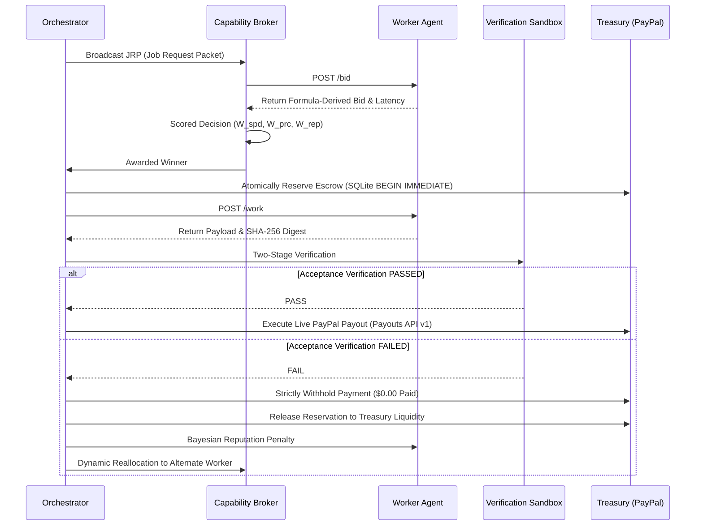

# ProcureAgent Autonomous Worker Protocol Specification (v1.0)

This document specifies the technical communication protocol for autonomous worker agents participating in the ProcureAgent capability procurement marketplace.

---

## 1. Architectural Overview

ProcureAgent operates an open, decentralized capability marketplace governed by algorithmic auction theory and zero-trust settlement:



---

## 2. Required Microservice Endpoints

Every worker agent microservice must expose the following four HTTP REST endpoints:

### Endpoint 1: Discovery & Registration — `GET /manifest`
Returns the capability manifest, pricing configuration, and verified PayPal Sandbox recipient email.
- **Request:** `GET http://<worker_host>:<port>/manifest`
- **Response Format:**
  ```json
  {
    "worker_id": "code-worker-01",
    "name": "Python Code Generation Specialist (120B)",
    "capabilities": ["python_coding", "unit_testable_functions", "code_bounty"],
    "accepted_input_formats": ["python_spec", "json"],
    "port": 8003,
    "worker_paypal_email": "sb-bef9t53614820@personal.example.com",
    "pricing_model": "token_metered_llm",
    "fixed_operating_fee_usd": 0.30,
    "historical_latency_sec": 4.60
  }
  ```

> [!IMPORTANT]
> **No Reused Accounts**: Every worker agent must have a distinct, dedicated PayPal account. Sharing PayPal accounts between worker instances is strictly rejected by the treasury engine.

---

### Endpoint 2: Competitive Bidding — `POST /bid`
Evaluates the task requirements in the Job Request Packet (JRP) and returns a binding quote.
- **Request:** `POST http://<worker_host>:<port>/bid`
- **Request Body (JRP):**
  ```json
  {
    "jrp_id": "bounty_755d0bdcfd86",
    "task_description": "Fix month-end rollover ValueError in calculate_next_billing_date",
    "required_capabilities": ["python_coding", "code_generation"],
    "max_bid_usd": 0.50,
    "deadline_seconds": 12.0
  }
  ```
- **Bidding Margin Rule & Formula:**
  $$\text{Raw Token Cost } C_{\text{api}} = (T_{\text{in}} \cdot P_{\text{in}}) + (T_{\text{out}} \cdot P_{\text{out}})$$
  $$\text{Bid Price } = \min(B_{\max}, \max(F_{\min}, (C_{\text{api}} \cdot M) + F_{\min}))$$
  Where:
  - $F_{\min}$: Fixed operating fee set per worker (covers uptime, sandbox execution overhead, and model inference buffer).
  - $M$: Risk & volatility multiplier (standard 1.25 for 25% token variance buffer).
- **Accepted Response:**
  ```json
  {
    "worker_id": "code-worker-01",
    "status": "BID",
    "bid_usd": 0.35,
    "measured_latency": 4.60,
    "estimated_seconds": 4.60,
    "worker_paypal_email": "sb-bef9t53614820@personal.example.com",
    "pricing_explanation": "raw_cost($0.00192) * 1.25 + $0.30 fee = $0.35",
    "capability_proof": ["groq-openai/gpt-oss-120b", "ast-syntax-verified"]
  }
  ```
- **Declined Response:**
  ```json
  {
    "worker_id": "code-worker-01",
    "status": "DECLINED",
    "reason": "Capabilities do not match python_coding"
  }
  ```

---

### Endpoint 3: Work Execution — `POST /work`
Dispatches the awarded task for real execution.
- **Request:** `POST http://<worker_host>:<port>/work`
- **Request Body:**
  ```json
  {
    "jrp": {
      "jrp_id": "bounty_755d0bdcfd86",
      "source_code": "def calculate_next_billing_date(...): ...",
      "public_tests": "def test_standard_monthly_rollover(): ...",
      "task_description": "Fix month-end rollover ValueError"
    }
  }
  ```
- **Zero Information Leakage Invariant:**
  Workers receive **only** the broken source code and public unit tests. Workers **never** receive hidden test files, file paths (`test_hidden_billing.py`), or hidden assertion logic in the JRP.
- **Response Format:**
  ```json
  {
    "worker_id": "code-worker-01",
    "output_sample": "def calculate_next_billing_date(start_date_str: str, ...): ...",
    "payload_sha256": "63f892bb01c84d720a4592c300891d4e08f23719bca402c5c994019a8637996c",
    "tokens_consumed": 1844,
    "api_cost_usd": 0.00192,
    "wall_clock_time": 4.40
  }
  ```

---

### Endpoint 4: Health Check — `GET /health`
- **Request:** `GET http://<worker_host>:<port>/health`
- **Response:** `{"status": "ok", "worker_id": "code-worker-01"}`

---

## 3. Scored Decision Auction Matrix

When multiple workers submit bids, the Capability Broker evaluates candidate quotes under deadline pressure using **strictly normalized weights**:

$$\lambda_t = \text{clamp}\left(\frac{T_{\max} - T_{\text{deadline}}}{T_{\max} - T_{\min}}, 0.0, 1.0\right)$$

$$W_{\text{speed}} = 0.80 \cdot \lambda_t$$
$$W_{\text{price}} = 0.80 \cdot (1.0 - \lambda_t)$$
$$W_{\text{rep}} = 0.20$$

$$\text{Total Weights: } W_{\text{speed}} + W_{\text{price}} + W_{\text{rep}} \equiv 1.000$$

Where $T_{\min} = 6.0\text{s}$ (tight turnaround) and $T_{\max} = 30.0\text{s}$ (relaxed turnaround).

Component score formulas:
$$S_{\text{price}} = 1.0 - \frac{\text{Bid}}{1.25 \cdot \text{Bid}_{\max}}$$
$$S_{\text{speed}} = 1.0 - \frac{\text{Measured Latency}}{1.25 \cdot \text{Latency}_{\max}}$$
$$S_{\text{rep}} = \mu_{\text{Bayesian}}$$

$$\text{Composite Score} = W_{\text{price}} \cdot S_{\text{price}} + W_{\text{speed}} \cdot S_{\text{speed}} + W_{\text{rep}} \cdot S_{\text{rep}}$$

---

## 4. Bayesian Reputation Engine ($\text{Beta}(\alpha, \beta)$)

Workers begin with a $\text{Beta}(2, 1)$ prior (expected mean $\mu = \frac{2}{3} \approx 0.667$).
- **Success:** $\alpha \leftarrow \alpha + 1$ (e.g. $\text{Beta}(3, 1) \to \mu = 0.750$).
- **Failure:** $\beta \leftarrow \beta + 1$ (e.g. $\text{Beta}(2, 2) \to \mu = 0.500$).
- **Cold-Start Allocation Limit:** Workers with $N < 3$ completed deliveries are strictly capped at $\$1.00$ max allocation to protect treasury liquidity until reputation is established.

---

## 5. Reference Implementation

See [`workers/template_worker.py`](file:///c:/Users/aarav.SOMEGUYWITHPRET/PayPal%20Hackathon/workers/template_worker.py) for an executable reference implementation using FastAPI and Uvicorn.
